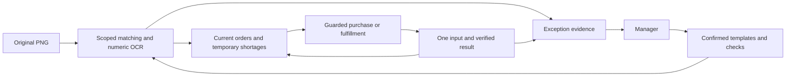

# MuMu Program and Management Workflow

## SOM Workflow — 2026-10-09

The native Monitor routes `settings.workflowMode = "som"` to `tools/som/`; `legacy` retains the previous perception/OCR/allocation coordinator. The SOM path uses a persistent lightweight geometry worker and local D1 crop classification. See [SOM workflow](som-workflow.md) for the loop, temporary-image storage, mode transition, timing and tested scope. Earlier quantity and registration implementation steps below describe the legacy path.

Updated 2026-10-07. Implementation root: `C:/Users/djfal/Documents/Codex/2026-10-02/task/Township`. This document owns the development sequence and component map. Use the [delivery guide](transport-play-guide.md) for policy, [operator contracts](mumu-operator.md) for execution and [capability index](remaining-implementation.md#policy-and-installation-status) for installed/candidate status. Workspace user instructions remain authoritative; implementation instructions add development procedures. Only the coordinate contract is mirrored byte-for-byte.

## Native Restart Policy Update (2026-10-07)

The [native restart contract](mumu-operator.md#native-monitor-restart-from-current-screens) supersedes older restart settlement requirements here. Native startup retires the old execution context after owner/helper exit checks, preserves stops and authority, and rebuilds orders from fresh screens without replaying or accounting for old input. Unresolved input still blocks new input within the same incarnation. Installation uses a checked, paused, owner-free boundary and preserves concurrent changes.

## Percentage Coordinates

Follow the [percentage coordinate contract](coordinate-contract.md). Missing or mismatched frame/viewport bindings and out-of-viewport targets hold input; never fall back to pixel-only execution.

## User-Supplied Town Recognition

Use the [registered town recognition scope](remaining-implementation.md#user-supplied-town-recognition). Scene recognition and facility detection do not establish input authority or supported action results.

## Responsibilities

Follow the [program and manager policy](AGENTS.md#program-and-manager). The program performs supported normal work; the manager handles exceptions, priority conflicts and improvements. Confirmed exception evidence should produce a bounded reusable correction.

The [current-order policy](transport-play-guide.md#current-orders-and-needed-goods) defines shortage calculation, shared-stock priority and reinspection. Persistent stock or completed-order history is not a native Monitor prerequisite.

## Screenshot Product Registration

The user's 2026-10-07 direction is to use actual game screenshots as product-image originals. A product without a registered screenshot enters AI manager observation and registration; wiki/catalogue artwork must not silently substitute for the missing screenshot. Product IDs and names may still come from the existing metadata catalogue. This is the requested workflow; installed coverage and remaining code changes are tracked in the [capability index](remaining-implementation.md#policy-and-installation-status).

1. When a product has no usable screenshot template, retain the exact original, frame ID, evidence hash, scene, viewport binding and slot region. Report a registration exception and hold decisions depending on that identity. Other supported work may continue under existing guards. A low score alone does not establish that the product is new.
2. The AI manager inspects the original and identifies the product from visible game evidence. Reuse saved originals first; obtain a clearer original or product-name detail only when necessary and permitted by the existing observation/input authority. An uncertain match or proposed catalogue ID is not confirmation. If identity remains uncertain, keep the exception open without assigning a guessed label.
3. Preserve the complete original and full product artwork, including captured checked and unchecked variants. Match a distinctive static crop, or use a hash-bound binary identity mask over the full product template to exclude quantity digits, completion checks, prices, selection decorations and animation. Keeping these pixels as evidence does not make them identity features. Preserve the original and record the crop hash, source frame/hash, source region and reviewed product ID. Reusable regions follow the percentage coordinate contract; pixel crop bounds remain derived raster evidence.
4. Add the crop to a separate candidate registration. A product may retain multiple screenshot templates, with unique template identities and a common product ID. Keep scene/geometry scope explicit; a market screenshot does not automatically establish delivery coverage. Do not replace valid existing variants merely because another original is available.
5. Replay representative positive, other-product negative and affected existing saved cases. A crop matching its own source is extraction evidence, not independent recognition coverage. Compare the best score per product against other product identities, so two variants of one product do not compete against each other. Keep unknown or inseparable results held. Apply the existing independent fixed-candidate validation requirement before behavior activation.
6. After validation, adopt the registration through the supported release process at a settled boundary and refresh affected workers/caches. Reinspect the current screen before resuming affected work; the historical registration original does not establish current order, stock, target or input freshness. Future ordinary matches use the registered screenshot templates without repeated AI review unless another exception occurs.

The existing `learn_helicopter_item` operation demonstrates screenshot-backed item registration, but it writes a profile directly and is not an independent validation or release-adoption step. `stageHelicopterCalibration` is a bounded legacy candidate builder. Neither entry establishes a complete shared market/train/airport registration loop. Do not invoke a direct installed-profile write to bypass candidate validation.

## Helicopter Order Evidence Survey

The native 1578x1268 helicopter coordinator first visits every currently recognized, supported order location and saves unobscured originals and full product crops. Unknown identity does not stop this first pass. Existing result verification, current percentage coordinates, ownership and stops remain required; an unresolved input or uncertain screen still stops additional clicks. A popup check runs before evidence storage and survey navigation.

After the first pass, collect separate name-information bundles for unknown products, verify return to the order screen, and continue supported work. Unknown identities and unread policy-critical quantities hold their affected orders. Reentry or a supported map change rebuilds the temporary survey; unchanged completed passes do not repeatedly open the same information popup.

`tools/mumu-helicopter-observation-evidence.mjs` saves full sources and scoped variants under `미인식/헬리콥터/observations/`. `tools/township-perception/harvest_helicopter_evidence.py` harvests existing PNGs offline and excludes recognized information popups or unverifiable popup state. Source hashes, frame IDs, full product crop bounds and fractional regions remain linked. All automatically collected identities stay `pending_ai`; a recognized candidate or completed file bundle is not a new identity registration or delivery approval.

For confirmed products, `masked_full_product` candidates retain a separate mask with hash, dimensions, binary-pixel, minimum-information and finite-score checks. The matcher takes the best candidate per product and preserves cross-product score/margin gates. Different captures keep their own source provenance; prior tooltip confirmation is explicitly linked as identity evidence, not misrepresented as the tooltip from another capture. Current installation and measured coverage are in the [capability index](remaining-implementation.md#policy-and-installation-status).

## Source Roots and SOM Boundaries — 2026-10-09

The running implementation is `C:/Users/djfal/Documents/Codex/2026-10-02/task/Township`. The chat workspace `C:/Users/djfal/OneDrive/문서/ChatGPT/Township` holds user instructions, plans and dated candidates; an older candidate there is not the running release. The current refactoring plan is [single-line JSON](C:/Users/djfal/OneDrive/문서/ChatGPT/Township/som-refactoring-plan-20261009.json). Its pinned manifest, independent verdict and installation receipt distinguish candidate validation from activation. Historical originals and prior receipts remain unchanged.

| Module under `tools/` | Responsibility |
| --- | --- |
| `mumu-workflow-mode.mjs` | Mode-specific worker/delivery construction, required-goods projection, pending-action binding and background OCR selection. Literal lazy imports keep both modes in the executable release manifest. |
| `mumu-delivery-status-reader.mjs` | Read-only producer-bound status; it does not instantiate a delivery coordinator. |
| `som/workflow.mjs` | Coordinate current domain decisions and invalidate domains at cycle boundaries. |
| `som/survey.mjs` | Own the disposable route, held/visited pins, current orders and image needs. |
| `som/market-visit.mjs` | Own grouping, offers, attempts, image memory, pages and scroll alignment for one visit. |
| `som/market-reset.mjs` | Own scan evidence and the optional exhaustion/deletion sequence; return decisions to the coordinator. |
| `som/barn-recovery.mjs` | Own allowed-tab inspection and one default-quantity sale per allowed tab during each recovery. |
| `som/actions.mjs`, `som/action-policy.mjs`, `som/geometry.mjs` | Pure intent/result validation, action effects/timing and geometry/proof helpers. Native input validation remains independent. |
| `som/delivery.mjs`, `som/input.mjs` | Orchestrate one observation/action/result and guarded native dispatch. |
| `som/need-images.mjs` | Persist disposable presentation images and provenance only when the manifest changes; repair missing/corrupt sidecars. |
| `som/worker.mjs`, `som/vision.py` | Persistent JSONL perception and one shared lazy numeric OCR engine. Shared request/reader utilities own protocol limits and timers. |
| `mumu-retention.mjs`, `mumu-evidence-dependencies.mjs` | Bound frame/action/visit metadata after preserving live evidence dependencies. |

Domain objects are in-memory work, not restart-restored order or stock ledgers. Mode switching still requires a paused, owner-free, input-settled boundary. Async module construction honors startup cancellation and closes constructed resources. Input/result timing is owned by `som/action-policy.mjs` and exposed through the shared scheduler; see [current timing](som-workflow.md#current-action-timing-and-refactoring--2026-10-09).

## Installed Components

| Component | Responsibility |
| --- | --- |
| `mumu-store.mjs`, `windows-device.mjs`, `adb.mjs` | Originals, input ownership, identity/geometry, preflight and immutable results |
| `mumu-capture.mjs`, `mumu-recognize.mjs` | Owned capture and requested Windows OCR |
| `township-perception/helicopter.py`, `mumu-helicopter.mjs` | Helicopter candidates, numeric pairs, program facts and exception learning |
| `mumu-helicopter-loop.mjs`, `mumu-automatic.mjs` | Supported action recipes and verified round continuation |
| `mumu-current-allocation.mjs`, `mumu-current-needs.mjs` | Native temporary orders, shortages and shared-goods allocation |
| `mumu-continuity.mjs`, `mumu-inventory*.mjs` | Standalone legacy coordination and inventory/history compatibility |
| `mumu-order-policy.mjs`, `mumu-management.mjs` | Whole-order policy, purchase and execution guards |
| `mumu-monitor.mjs`, Township Monitor | Observation control and shared read-only status |
| `mumu-monitor-snapshot.mjs`, `mumu-monitor-evidence.mjs` | Read-only query worker and hash-verified display evidence reuse |
| `mumu-monitor-delivery*.mjs` | Serialized native transport, market, routing and event coordination |
| `mumu-train-reward-proof.mjs`, `mumu-train-rewards.mjs` | Registered protected-cargo claims and same-row/slot result proof |
| `mumu-town-navigation.mjs` | Current target preparation, bounded search and guarded reviewed navigation |
| `mumu-performance.mjs` | Capture/input latency, useful deliveries and manager-intervention measurements |

Reuse the existing `.venv-perception` OpenCV/RapidOCR workers. Keep heavy recognition outside state locks. Program facts require their scoped source/profile proof; generic candidates and detection alone do not authorize input.

## Independent Train-Slot Support (Installed)

Use the [train-slot scope and evidence](remaining-implementation.md#independent-train-slot-support-installed). Its 1114x735 loading support does not extend to 1578x1268. Historical installation hashes, numeric examples and validation results belong to the linked [application report](artifacts/train-slot-activation-20261006/train-slot-implementation-report.md), not the operating sequence.

## Execution

For authorized live work, follow [startup contracts](mumu-operator.md#preparation-before-starting): connect configured paths, check stops/ownership/unresolved input, then use Monitor's owned program path. Its callback awaits recognition, action and result verification before the next ordinary capture. Never run a separate coordinator concurrently with Monitor input ownership. Connect/status/Refresh are read-only.

Use `node tools/mumu-cli.mjs SESSION_ROOT request REQUEST_JSON` with the operation appropriate to the task:

| Operation | Effect |
| --- | --- |
| `observe_helicopter` with `offline=true`, `commit=false` | Analyze a saved original without committed review or game input; see the [saved-image request](mumu-operator.md#saved-image-inspection). |
| `helicopter_round` | Run supported deliveries, deletions and navigation under existing authority and guards. No offline mode: adding `offline=true` does not disable execution. |

The standalone legacy entry `node tools/mumu-continuity-cli.mjs SESSION_ROOT run REQUEST_JSON` remains available only with exclusive ownership; see [continuing management](continuing-management.md). Productive invocation yields and completed rounds do not end an authorized continuing task. Individual action recipes retain their source/result limits and deadlines.

For a needed restart at a settled boundary, use the already authorized [guarded restart procedure](apps/TownshipMonitor/README.md#restart-without-computer-use). It preserves saved stops, configured paths and unresolved-input evidence; it grants no gameplay authority. Offline edits and document validation need no Monitor startup or restart.

## Current Scope and Improvements

1. Check the [current capability and geometry boundaries](remaining-implementation.md#geometry-and-evidence-boundaries). Separate recognition, supported action/result transitions, candidate validation and live verification.
2. Define one observable success condition and try the smallest existing-code, region or template change. Exclude irrelevant animation before adding variants or abstractions. Finish independent small registrations before unrelated improvements.
3. Reuse valid originals and obtain only missing evidence. Develop behavior changes in a separate working copy, preserving others' edits and the previous working version.
4. Apply [scoped validation](AGENTS.md#simple-improvements-and-validation): representative positive, negative and affected existing cases. Use one independent validator on a fixed behavior candidate before activation. Document-only edits need a scoped diff and consistency check, without a separate validator.
5. Activate only at the [settled boundary](mumu-operator.md#validation) with no pending/unknown input and no conflicting owner. Adopt executable changes through the supported release command, then use guarded restart when needed; do not clear runtime state to pass a hold.

The [maintenance plan](C:/Users/djfal/OneDrive/문서/ChatGPT/Township/program-maintenance-work-plan.md) records completed items and remaining evidence/measurement decisions. Select only applicable unfinished work. Installation, restart, process liveness and offline timing do not establish live performance or the separate 15-minute full-plan acceptance.

## Execution and Result Boundaries

Unknown/unresolved input and uncertain action results block all game input. Recognition-only exceptions hold affected work; other supported work may continue under existing authority, stops, allocation and ownership guards. The input executor checks both the current pointer and all unresolved actions; final preflight may exclude only its own exact pending action.

Use the [operator verification contract](mumu-operator.md#target-verification-and-exceptions) for current geometry, critical fields, immediate preflight and result evidence. Verify each purchase, delivery or reward before another input. Unknown reward quantities do not require a stock-history audit and must not be invented.

Monitor reports hold scopes (`order`, `transport`, `observation`, `global`). Successful and failed recognition have separate caches. Transient recognition failures retry only on new originals, with 1-second and 4-second initial delays, followed by 15-, 30- and at most 60-second observation backoff. Changing PNG bytes does not restart the short burst. Failed workers are recreated; an admitted pending-result observation may recover workers while preserving its input record. Deterministic unsupported evidence waits for a relevant change. Recognition retries never repeat game input.

`mumu-execution-release.mjs` derives executable identity from code, native sources, dependency locks and recognition registrations. Documentation changes do not install a candidate or alter runtime state.

Related saved-image tests use hash-checked originals under `reference/test-evidence`. Set `TOWNSHIP_TEST_PYTHON` to an existing perception environment when testing from another working copy. Pure routing tests require no OCR process.

## Restart and Verification Reuse

After restart, rebuild current orders and temporary needs from screens once existing guards permit observation, as defined in [continuing management](continuing-management.md#continuing-work). Preserve unresolved-input evidence, stops, authorization and ownership separately; never reconstruct completed missions or replay stock deltas as a prerequisite.

Train and airport numeric observations use the same observation backoff as helicopter observations. A failed worker can be recreated for the next eligible observation; this does not retry game input. Changed source bytes, profiles or geometry invalidate the affected recognition proof. Historical installation evidence remains in the [capability index](remaining-implementation.md#historical-evidence) and linked reports.

## Helicopter hold display (2026-10-08)

The read-only `operationStatus` snapshot separates registration waits, unread quantities, unsupported locations, stock shortages, market refresh, current barn-space holds versus required rechecks, unresolved input and user pause. The Monitor shows affected orders, ready orders, resume conditions and source/result references. Status queries never resume gameplay. See the [capability index](remaining-implementation.md) for installed status and the still-disabled automatic barn-sale route.
